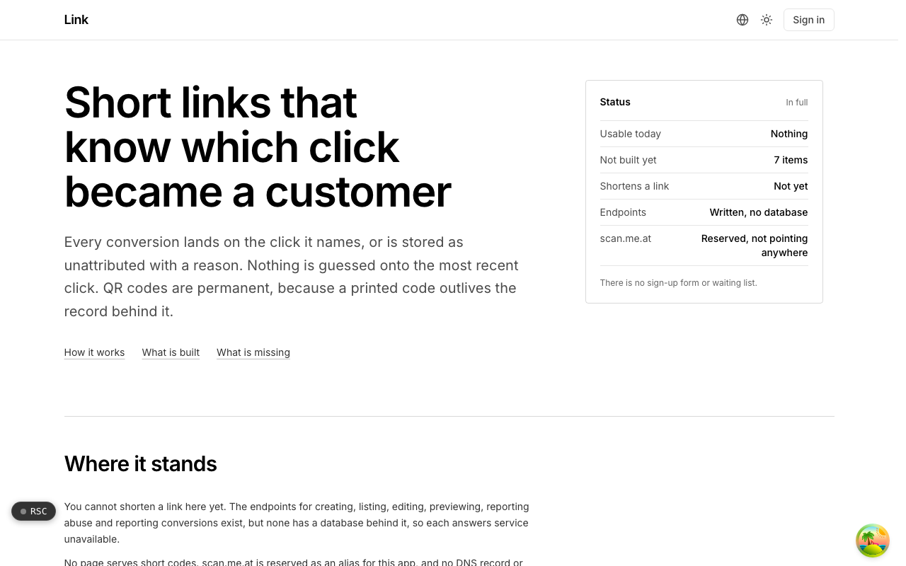

  <picture>
    <source media="(prefers-color-scheme: dark)" srcset=".github/assets/hero-dark.png">
    
  </picture>

# link.me.at

Short links that know which click became a customer.

Link is a short-link product: short links on a domain you own, each with a matching QR code and attribution analytics that say which click actually became a signup. Every conversion lands on the click it names, or is stored as unattributed with a reason; nothing is guessed onto the most recent click. QR codes are permanent, because a printed code outlives the record behind it. Link is in active development, and its landing page states what is built and what is still missing.

## Features

- **Honest attribution**: a conversion is joined to a click only when it names that click inside the attribution window; anything else is kept as unattributed, with the reason.
- **Bots are counted separately**: every click is classified as human, self-declared bot, link-preview fetch or unclassified, without fingerprinting.
- **Bad destinations are refused up front**: URL shape, phishing patterns, shortener chains, an optional threat-intelligence lookup and creation rate are checked before a link exists.
- **Links are re-checked later**: a scheduled sweep re-screens live links and disables one that has gone bad, with an audit record.
- **Printed QR codes keep working**: the short URL inside a QR code is fixed on first generation, and a code is never reused for a different destination.
- **One 404 for every dead code**: unknown, expired and disabled codes all answer the same response, so nobody can enumerate which codes exist.
- **Private redirects**: redirects are sent with no-referrer, no-store and noindex, and read only a precomputed copy of the link.
- **API keys, custom domains and password-locked links** for programmatic and branded use.

## Built with

- Next.js 16 (App Router), React 19, TypeScript
- Tailwind CSS 4
- oRPC for the typed API, plus a REST API for API-key access
- Drizzle ORM + Postgres
- Better Auth (the shared me.at account)
- uqr for QR codes, isbot for bot classification

## Part of the me.at family

link.me.at is one of my [`*.me.at`](https://me.at) apps. They share one design system, account, and app shell. Development happens in a private monorepo; this repository is the project's public-facing home.

## License

See [LICENSE](LICENSE).
